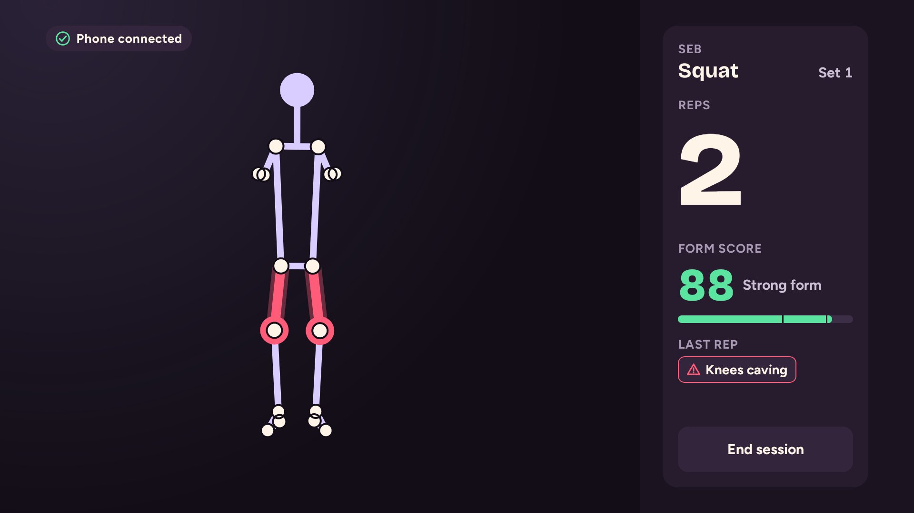
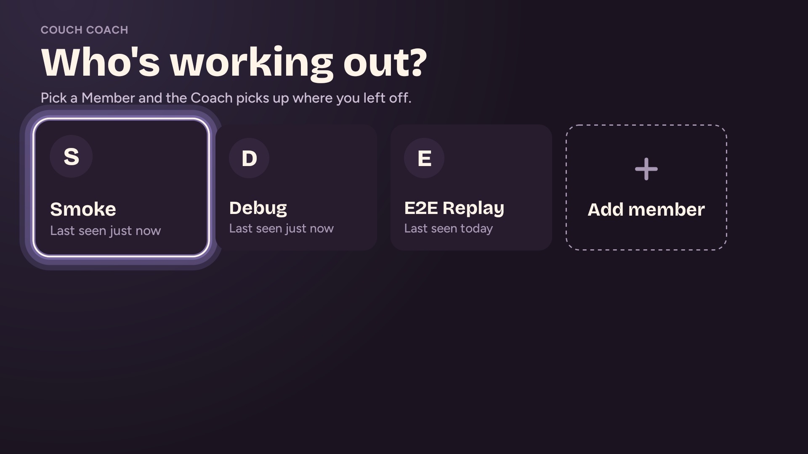
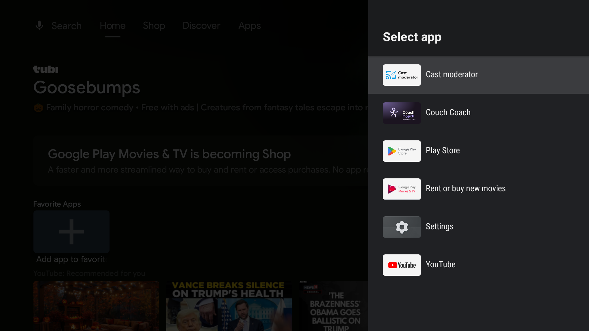
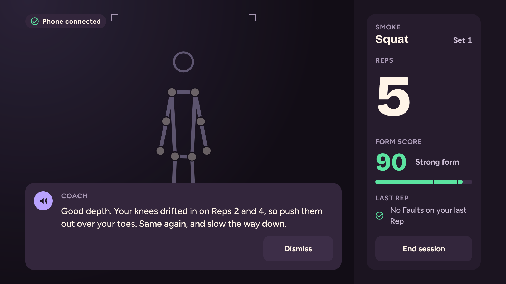
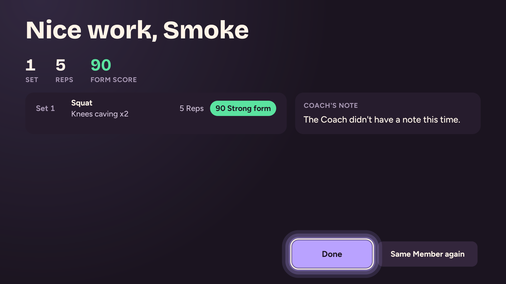
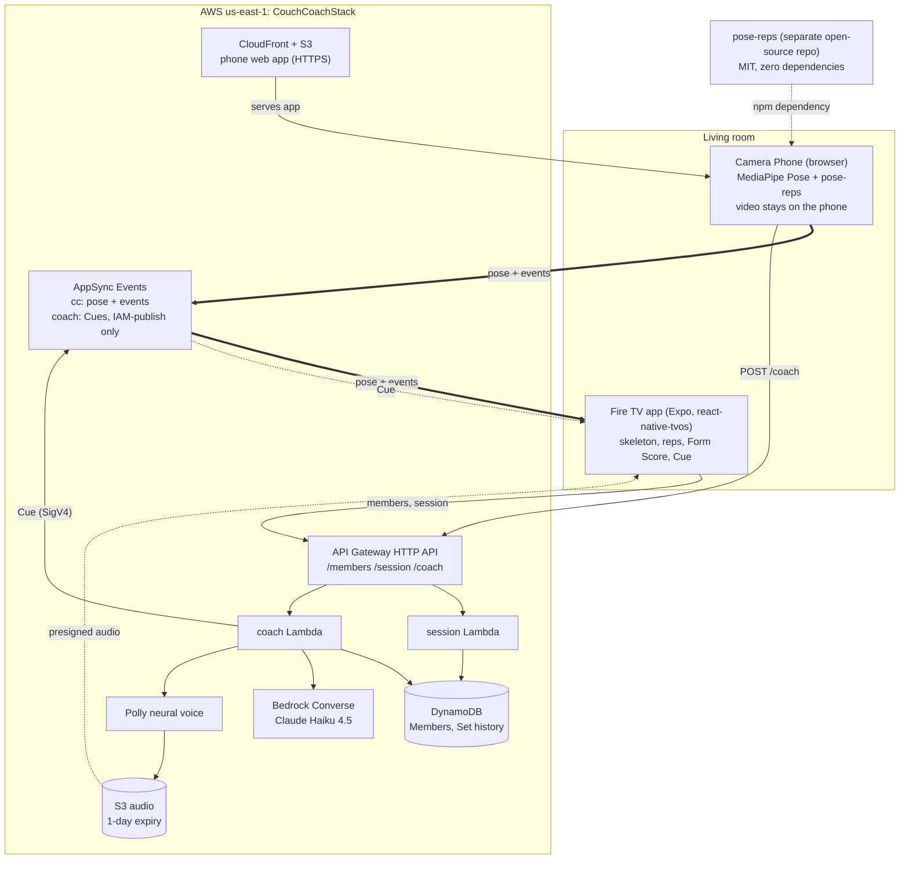

# Couch Coach

**A living-room fitness coach for Fire TV.** Your phone is the camera and tracks your body on the device; the Fire TV draws your live skeleton and shows your rep count and form score; an AI coach on AWS speaks a short, specific Cue after each set and remembers each person in the household.

Built for **Build, Ship, Shape: Amazon Developer Hackathon** (Fire TV track; AWS Builder and Open Source mini challenges).



<sub>The Live screen from the Android TV emulator. The poses are synthetic (`apps/tv/scripts/publish-synthetic.mjs` plays a fake phone); the app talks to the deployed backend.</sub>

| Members | Pair | Cue | Recap |
|---|---|---|---|
|  |  |  |  |

## Why it matters

Working out in front of the TV usually means following a video that cannot see you. A Fire TV has no camera, but everyone in the room has a phone with a good one. Couch Coach uses it:

- **Feedback you can act on.** "Your knees drifted in on Reps 2 and 4, so push them out over your toes" beats a generic "good job". The app measures; the model only says what was measured.
- **Private by construction.** Video never leaves the phone. Only 33 body landmarks per frame and rep summaries go out ([Privacy](#privacy)).
- **It remembers people.** Each Member's last five sets feed the next Cue, so the Coach can say whether a fault is getting better.
- **Cheap to run.** No always-on servers, and hard spend limits.

It is a form coach, not a medical tool: it makes no health claims, and tells anyone in pain to stop and rest.

## How it works

1. On the TV, pick a Member (or add one). The TV asks the backend for a Session and shows a QR code.
2. Scan it with a phone. The phone page asks for the camera and joins the Session.
3. The phone runs MediaPipe Pose on-device and counts reps with [`pose-reps`](https://github.com/SebAustin/pose-reps). It publishes landmarks (about 15 fps) and rep events over AWS AppSync Events.
4. The TV draws the skeleton, the rep count and the Form Score, and highlights the limb behind a fault.
5. When a set ends (button, or 8 s without movement), the phone calls `POST /coach`. A Lambda reads the Member's last five sets, asks Claude Haiku 4.5 on Amazon Bedrock for a two-sentence Cue, voices it with Amazon Polly and pushes it to the TV.
6. Ending the Session shows a Recap.



Details, the full sequence of one Session, the security model and failure handling are in [docs/architecture.md](docs/architecture.md). Decisions are recorded in [docs/adr](docs/adr).

## Tracks and mini challenges

- **Fire TV (primary).** A 10-foot, D-pad-driven Android TV app for Fire OS (Leanback launcher, TV banner, network permissions only). It started from Amazon's [react-native-multi-tv-app-sample](https://github.com/AmazonAppDev/react-native-multi-tv-app-sample) (Expo 54, `react-native-tvos`). The skeleton is drawn with SVG updated imperatively through a jitter buffer, not by re-rendering React per frame.
- **AWS Builder.** One CDK stack, listed below.
- **Open Source.** [`pose-reps`](https://github.com/SebAustin/pose-reps) is a separate MIT library with no runtime dependencies: it counts squats and jumping jacks from MediaPipe landmarks, names form faults and scores each rep. Tagged `v0.1.2`, CI, 92 tests, 97.8% statement coverage. The `dist/` is committed so a git install needs no build step; an npm registry release is pending.

| AWS service | What it does here |
|---|---|
| AWS AppSync Events | Realtime pub/sub between phone and TV: pose batches, rep events, presence heartbeat; Cues on a separate IAM-publish-only namespace |
| Amazon Bedrock (Converse, Claude Haiku 4.5) | Writes the Cue from the measured set plus the Member's last five sets |
| Amazon Polly (neural) | Speaks the Cue |
| AWS Lambda (Node 24, arm64) | `session` (Members, Sessions, tokens) and `coach` (caps, Bedrock, Polly, publish) |
| Amazon API Gateway (HTTP API) | `GET/POST /members`, `POST /session`, `POST /coach`, with per-route throttles |
| Amazon DynamoDB | Members, per-Member Set history (the Coach's memory, 90-day TTL), Session cap and daily quota counters |
| Amazon S3 | Phone web app bucket; Cue audio (1-day expiry, presigned URLs) |
| Amazon CloudFront | Serves the phone app over HTTPS (browsers require it for the camera) |
| AWS Secrets Manager | HMAC key that signs phone tokens |
| Amazon CloudWatch, Amazon SNS, AWS Budgets | Logs, five alarms (errors, 5xx, spend spikes), email alerts, a $50 monthly budget |
| AWS IAM, AWS CDK | Least-privilege roles; the whole stack is TypeScript CDK |

## Repo layout

```
apps/tv/                 Fire TV app (Expo 54, react-native-tvos, Yarn 4). Has its own README and DEPLOYMENT.md
apps/phone/              Camera Phone web app (Vite + TypeScript, MediaPipe, pose-reps)
packages/protocol/       zod schemas, frame codec, channel names: the wire contract
packages/events-client/  AppSync Events WebSocket client, no Amplify
services/session/        Members and Session Lambda
services/coach/          Coach Lambda (Bedrock, Polly, caps) and the Cue eval in eval/
services/shared/         token, HTTP and logging helpers
infra/                   CDK stack, tests, write-client-config script
scripts/                 e2e-replay.ts (latency check), debug-session.ts, replay-export.ts
docs/                    architecture.md, runbook.md, adr/, CONTRACTS.md, ux.md
CONTEXT.md               glossary: Member, Session, Set, Rep, Fault, Form Score, Cue, Recap
SECURITY.md              threat model, findings and remediation status
PLAN.md, STATUS.md       plan of record and current status
../pose-reps/            sibling checkout (separate repo); the phone app and scripts depend on it by path
```

Each package under `packages/`, `services/`, `apps/phone`, `infra` and `scripts` has its own `package.json` and lockfile; there is no npm workspace. `apps/tv` is a Yarn workspace of its own.

## Quick start for judges

### (a) Watch the demo

[Watch the demo video](VIDEO_URL) <!-- replace VIDEO_URL with the public YouTube link -->

### (b) Run it on a Fire TV against the deployed backend

Nothing to deploy and no AWS account needed. The APK has the demo backend's public client settings baked in (`infra/client-config.json`).

You need a Fire TV and a computer on the same Wi-Fi, `adb` (`brew install --cask android-platform-tools` on macOS), and a phone with a camera (tested on iPhone Safari).

```bash
git clone https://github.com/SebAustin/couch-coach.git
cd couch-coach/apps/tv
mkdir -p dist && curl -L -o dist/couch-coach.apk APK_URL     # replace APK_URL with the release asset link
bash scripts/fire-tv-wizard.sh
```

The wizard walks you through six steps: turn on ADB debugging on the Fire TV, find its IP, accept the debugging prompt, install the APK and launch it, then do a first live Session with a short checklist (pick a Member, scan the QR with your phone, do five squats, end the set, hear the Coach). If `dist/couch-coach.apk` is missing it offers to build it with `yarn build:apk`, which needs the toolchain in [apps/tv/README.md](apps/tv/README.md).

Things to know:
- Prop the phone upright 2 to 3 m away so your whole body, head to feet, is in frame. For squats stand with the phone about 45 degrees in front of you; for jumping jacks face it.
- The Member list on the demo backend is shared and has no login. Add a first name or nickname, not anything you would not want others to see.
- The demo backend limits Cues to 300 a day and 30 per Session. If Cues stop, that is the limit ([runbook](docs/runbook.md#troubleshooting)).
- The shared backend and its public key are planned to be shut down after judging (the key expires on 2026-12-15 regardless).

No Fire TV? Run the TV app in a browser and let a script play the phone:

```bash
cd apps/tv && yarn install && yarn dev:web                    # http://localhost:8082
# in a second terminal, from apps/tv:
node scripts/publish-synthetic.mjs --wait 10 --reps 5 --faults knees_caving,torso_lean --end   # prints a "Web preview" URL to open
```

### (c) Deploy your own stack

Needs Node 22 or newer, an AWS account with CLI credentials, and **Bedrock access to Claude Haiku 4.5 in `us-east-1`** (new accounts must submit Anthropic's use-case form first; without it Cues fall back to plain templates). For the APK you also need Yarn 4.5, JDK 17 and the Android SDK. Steps and the commands to check them are in the [runbook](docs/runbook.md).

```bash
git clone https://github.com/SebAustin/pose-reps.git                 # must sit next to couch-coach
git clone https://github.com/SebAustin/couch-coach.git && cd couch-coach

# Install every npm package. The shared ones (protocol, events-client, services) must be installed too:
# the others link to them by path and resolve their imports (zod) from the linked folder.
for d in packages/protocol packages/events-client services/session services/coach apps/phone infra scripts; do (cd $d && npm ci); done
(cd apps/phone && npm run build)                                     # build the phone app before deploying, so the stack uploads it

cd infra
npx cdk bootstrap -c budgetEmail=you@example.com                     # once per account and Region
npx cdk deploy    -c budgetEmail=you@example.com --outputs-file cdk-outputs.json
npm run write-client-config                                          # cdk-outputs.json -> client-config.json
cd ..

cd apps/tv && yarn install && yarn sync                              # bakes your client-config.json into the TV app
source scripts/android-env.sh && yarn build:apk                      # -> dist/couch-coach.apk
bash scripts/fire-tv-wizard.sh                                       # sideload and first Session, as in (b)
```

`budgetEmail` receives the $50 budget and alarm emails (click the SNS confirmation link). It is never stored in the repo, and every `cdk` command needs it. The phone app finds the API through a `config.json` that CDK writes into its bucket, so it needs no extra step. `npx cdk synth -c budgetEmail=you@example.com` and `npm run build` in `apps/phone` check your setup without touching AWS. To remove everything: `npx cdk destroy -c budgetEmail=you@example.com`.

## Testing

Test counts from a fresh clone of `main` on 2026-10-21 (vitest for everything except the TV app, which uses jest):

| Package | Tests | Command |
|---|---:|---|
| `packages/protocol` | 13 | `npm test` |
| `packages/events-client` | 52 | `npm test` |
| `services/session` | 32 | `npm test` |
| `services/coach` | 108 | `npm test` |
| `apps/phone` | 43 | `npm test` |
| `infra` (CDK assertions) | 50 | `npm test` |
| `apps/tv` | 133 | `yarn test` |
| `pose-reps` (separate repo) | 92 | `npm test` |

From a clean checkout (with `pose-reps` cloned next to it), install the packages first, then run the tests:

```bash
for d in packages/protocol packages/events-client services/session services/coach apps/phone infra scripts; do (cd $d && npm ci); done
npm test                      # repo root: runs the six npm packages above (not apps/tv, not pose-reps)
npm run typecheck             # same, for tsc
(cd apps/tv && yarn install && yarn test && yarn typecheck)
(cd ../pose-reps && npm ci && npm test)
```

CI runs the npm packages on every push (`.github/workflows/ci.yml`).

**End-to-end replay against the deployed stack.** `scripts/e2e-replay.ts` plays phone and TV at once: it publishes synthetic pose batches, then calls the real Coach for each set and times the Cue.

```bash
cd scripts && npm run e2e                   # defaults: 75 batches, 3 sets. Needs `npm ci` in scripts and the shared packages, and infra/client-config.json
```

| Criterion | Target | Result | |
|---|---|---|---|
| SC1: pose, phone to TV, p95 | < 300 ms | about 330 to 400 ms (p50 about 210 ms) in the runs recorded in the git log | **Misses the target** |
| SC5: set end to Cue, with Bedrock and Polly | < 5 s | 1.9 to 2.5 s in those runs | Passes |

A default run from a fresh clone on 2026-10-21 gave SC1 p50 170 ms, p95 325 ms (75 of 75 batches received, still a fail) and SC5 p95 3.8 s: the first Cue (3.8 s) probably included a Lambda cold start, the next two took about 1.6 s. A shorter 15-batch run gave p95 529 ms, so treat SC1 as "around 300 to 500 ms from a laptop". The script exits non-zero when either check fails. The TV also buffers 150 to 450 ms on purpose so the skeleton moves smoothly.

**Coach eval.** `cd services/coach && npm run eval` runs the real prompt against Bedrock on 12 fixed cases twice (24 calls; needs AWS credentials) and scores each Cue with deterministic rules: at most 35 words and 2 sentences, names the main fault's body area, never contradicts the fault data, no invented trends or body parts, name used at most once. Result: **24 of 24 pass (100%)**, up from 29% before the prompt rework. Saved in `services/coach/eval/results/latest.json`; details in [services/coach/eval/README.md](services/coach/eval/README.md). The checks are keyword rules: they do not judge tone or variety.

**Rep counting on real data.** `pose-reps` has a regression test on a real phone recording (a squat set, 236 frames over about 19 s, landmarks only) replayed at the recorded 12.5 fps and resampled to 20, 25 and 30 fps with seeded jitter. It guards against phantom reps and invented faults. Honest result: the owner counted 9 to 10 squats; the engine counts 6, because the landmarks of the first 5.5 s carry no knee bend. The test pins that on purpose.

## Security

A STRIDE threat model plus code, dependency and live read-only checks is in [SECURITY.md](SECURITY.md). It found 0 critical and 2 high issues; both high issues are fixed and deployed:

- **Public AppSync key could read and forge into every Session.** Now: wildcard subscriptions are rejected, Cues travel on a namespace only the coach Lambda can publish to (IAM/SigV4), and the TV plays audio only from S3 over HTTPS ([ADR 0006](docs/adr/0006-iam-only-coach-namespace.md)).
- **Unlimited Sessions meant unbounded spend.** Now: a daily ceiling of 300 Cues, 30 per Session, coach concurrency of 3, per-route throttles and spend alarms.

Also: phone tokens are HMAC-SHA256, bound to one Session, valid 2 hours; Lambda roles are least-privilege; the model has no tools; no secrets are in the repo (the AppSync key is a public client key by design and expires 2026-12-15).

Still open, and accepted for a demo: one shared unauthenticated Household (M1), anyone who sees a Session's QR can publish noise into that Session for 2 hours, the APK is signed with the public debug key (so it is sideload-only), and the LOW items in SECURITY.md.

## Privacy

- **Video never leaves the phone.** MediaPipe runs in the phone browser. What is sent: 33 `[x, y, visibility]` landmarks per frame at about 15 fps, rep events and set summaries ([ADR 0001](docs/adr/0001-pose-estimation-on-the-phone.md)).
- Landmarks pass through AppSync to the TV and are not stored. They are still body-movement data, so Session ids are unguessable 128-bit values.
- Stored: a Member's display name, set summaries (reps, score, fault counts) and Cue text for 90 days; Cue audio for 1 day. There are no accounts and no analytics.
- A Member's name and set summary go to Amazon Bedrock in the prompt, and the Cue text goes to Polly.

## Known limitations

- **Real-device testing.** The TV app has been verified on the Android TV emulator against the live API, and the phone on real iPhone and desktop cameras. A run on a physical Fire TV is not recorded in this repo as of 2026-10-21. Android Chrome on the phone side is untested.
- **SC1 misses its target** (above), and the phone's pose rate varied between 7.5 and 15 fps in the first live test.
- **Form heuristics are 2D and angle-dependent.** `pose-reps` is calibrated on synthetic data and one real recording. Faults are deliberately conservative because false accusations were seen in early live tests, so real faults will sometimes be missed. See its README.
- **Scope.** One person per Session, two exercises (squat, jumping jack), Fire OS sideload only (no Vega build, no store listing), English voice only.
- **Coach quality** is checked by rules on 12 cases, not by listening tests. The Coach is Bedrock Converse plus DynamoDB history, not AgentCore ([ADR 0004](docs/adr/0004-bedrock-converse-instead-of-agentcore.md)).
- **Shared demo backend**: shared Member list, 300 Cues a day, planned shutdown after judging.

## More documents

- [docs/architecture.md](docs/architecture.md), [docs/runbook.md](docs/runbook.md), [docs/adr](docs/adr), [docs/CONTRACTS.md](docs/CONTRACTS.md), [docs/ux.md](docs/ux.md)
- Hackathon material: [SUBMISSION.md](SUBMISSION.md), [DEMO.md](DEMO.md), [PRODUCT_FEEDBACK.md](PRODUCT_FEEDBACK.md), [FRICTION_LOG.md](FRICTION_LOG.md)
- App READMEs: [apps/tv](apps/tv/README.md) ([DEPLOYMENT](apps/tv/DEPLOYMENT.md)), [apps/phone](apps/phone/README.md), [events-client](packages/events-client/README.md)

## Credits

- `apps/tv` is derived from [AmazonAppDev/react-native-multi-tv-app-sample](https://github.com/AmazonAppDev/react-native-multi-tv-app-sample), MIT No Attribution (MIT-0); see `apps/tv/LICENSE`.
- Pose estimation: [MediaPipe](https://ai.google.dev/edge/mediapipe) Pose Landmarker (lite model) via `@mediapipe/tasks-vision` (Apache-2.0).
- D-pad focus: `react-tv-space-navigation`. Schemas: zod. Infrastructure: AWS CDK.

## License

[MIT](LICENSE). `pose-reps` is MIT too, in its own repository.
