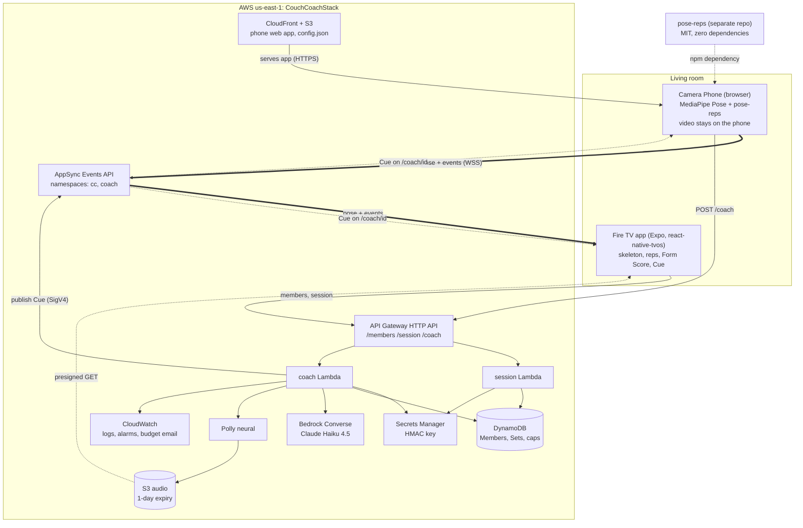
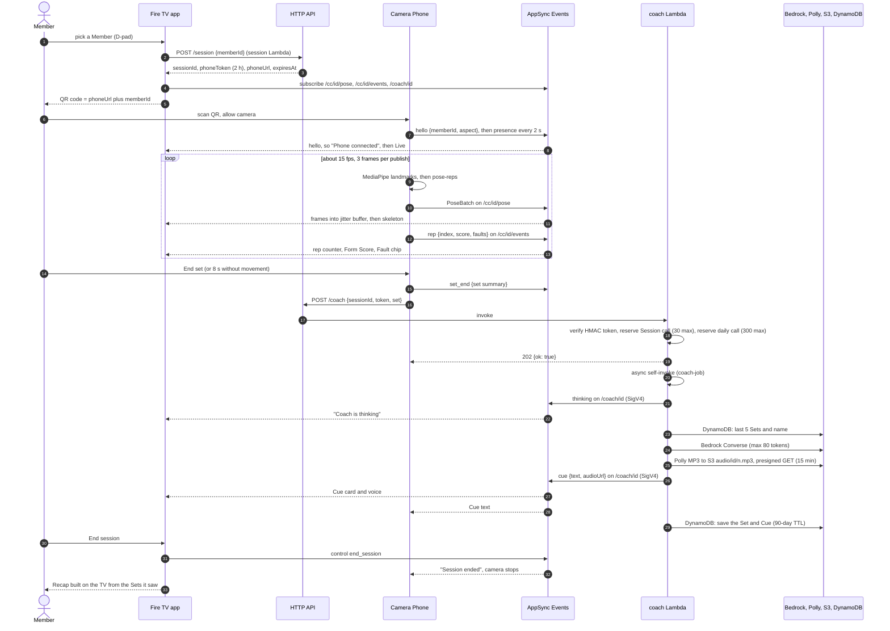

# Architecture

Couch Coach is a Fire TV app, a phone web app and a small serverless backend on AWS (one CDK stack, `us-east-1`). The phone is the camera and does all vision work. The TV only draws. The cloud carries messages and writes the Coach's feedback.

Terms (Member, Session, Set, Rep, Fault, Form Score, Cue, Recap) are defined in [`CONTEXT.md`](../CONTEXT.md). The wire contract is [`packages/protocol/src/index.ts`](../packages/protocol/src/index.ts); [`CONTRACTS.md`](CONTRACTS.md) explains it.

## Components

| Component | Where | What it does |
|---|---|---|
| Fire TV app | `apps/tv` | Members, Pair (QR), Live, Recap. Subscribes to a Session's channels, smooths phone frames in a jitter buffer and draws the skeleton imperatively (no per-frame React render). Plays Cue audio. Sideloaded Android TV APK. |
| Camera Phone | `apps/phone` | Vite + TypeScript, no UI framework. Runs MediaPipe Pose Landmarker (lite model, self-hosted) and `pose-reps` in the browser. Publishes only 33 landmarks per frame and events. Calls `POST /coach` at the end of a Set. |
| `pose-reps` | `../pose-reps` ([repo](https://github.com/SebAustin/pose-reps)) | Counts squats and jumping jacks, names Faults, scores each Rep (100 minus fault weights). Pure TypeScript, no runtime dependencies, committed `dist/`. |
| `@couch-coach/protocol` | `packages/protocol` | zod schemas for every message, frame codec, channel names. Single source of truth. |
| `@couch-coach/events-client` | `packages/events-client` | Hand-written AppSync Events WebSocket client, no Amplify ([ADR 0003](adr/0003-appsync-events-without-amplify.md)). Shared by phone and TV (the TV gets a vendored copy from `yarn sync`). |
| `session` Lambda | `services/session` | `GET/POST /members`, `POST /session`. Creates the Session row and signs the phone token. |
| `coach` Lambda | `services/coach` | `POST /coach`: verifies the token, enforces the per-Session cap and the daily ceiling, then does the slow work in an async self-invoke: history, Bedrock, Polly, publish ([ADR 0004](adr/0004-bedrock-converse-instead-of-agentcore.md)). |
| Infra | `infra/` | One CDK stack. Bedrock invoke rights cover the Haiku inference profile and its underlying foundation models only. |
| Scripts | `scripts/` | `e2e-replay.ts` (latency check against the deployed stack), `debug-session.ts`, `replay-export.ts`. |

Lambdas run Node 24 on arm64, bundled with esbuild. The session and coach functions share one DynamoDB table.

## Data flow of one Session

Notes on the flow:
- **Video never leaves the phone.** Only `[x, y, visibility]` for 33 landmarks per frame goes out ([ADR 0001](adr/0001-pose-estimation-on-the-phone.md)).
- **The Coach's memory** is the Member's last five Sets in DynamoDB (`MEMBER#<id>` / `SET#<ts>`, 90-day TTL). There is no vector store and no agent runtime.
- **Rep and Fault decisions are made on the phone**, by `pose-reps`. The coach prompt receives measured facts (main Fault, how many Reps, trend against earlier Sets) and is told to say only that. This is why the eval in `services/coach/eval` can check Cues with deterministic rules.
- **Delivery is at-least-once.** The TV dedupes `rep` by index and `set_end` by `setIndex`, and drops late Cues for older Sets.
- **There is no Recap endpoint.** The TV assembles the Recap from the Sets it saw plus the last Cue.

### What is stored in DynamoDB

| Key | Written by | Content |
|---|---|---|
| `HOUSEHOLD#default` (GSI `byHousehold`) | session | one shared Household; listing Members is a sparse-index query (max 20 Members) |
| `MEMBER#<id>` / `PROFILE` | session | name, `lastSeenAt`, optional `hidden` flag (omitted from `GET /members` unless `?includeHidden=1`; still counts toward the 20-Member cap) |
| `MEMBER#<id>` / `SET#<ms>` | coach | exercise, reps, score, fault counts, Cue text; TTL 90 days |
| `SESSION#<id>` / `META` | session, coach | `memberId`, `exp`, `coachCalls` (the cap counter) |
| `QUOTA#<yyyy-mm-dd>` / `DAY` | coach | global daily counter; TTL 2 days |

## AppSync Events: namespaces and security model

One Events API, two namespaces. Every client holds the same public API key (it is in the repo, the APK and the phone's `config.json`). Security does not come from keeping the key secret. It comes from who may publish where, and from what may be subscribed.

| Namespace | Channels | Subscribe | Publish | Who publishes |
|---|---|---|---|---|
| `cc` | `/cc/<id>/pose`, `/cc/<id>/events` | API key | API key | phone (pose, events, presence), TV (`control: end_session`) |
| `coach` | `/coach/<id>` | API key | **IAM only** | the coach Lambda, signed with SigV4 |

- `<id>` is the 128-bit Session id (32 hex characters). An `onSubscribe` handler on each namespace accepts only the exact path shape and rejects any path containing `*`, so one subscriber cannot read every Session ([ADR 0006](adr/0006-iam-only-coach-namespace.md)).
- Connection auth is the API key only. The IAM provider exists only so the coach Lambda can publish to `coach`; clients never use it.
- The coach Lambda has no API key in its environment. Its role can call `appsync:EventPublish` on the `coach` namespace and nothing else on AppSync.
- The API key expires on 2026-12-15 and is revoked after judging (see the [runbook](runbook.md)).
- **Residual risk:** someone who has seen a Session's QR knows its id and can publish noise to `/cc/<id>/pose` and `/events` for the life of the token (2 h). A Lambda authorizer would close it. This and the other open findings (M1 shared Household, the LOW items) are in [`SECURITY.md`](../SECURITY.md).

### Other trust boundaries

- **Phone token.** `base64url(sessionId.exp)` + `.` + `base64url(HMAC-SHA256(key, sessionId.exp))`, valid 2 h, bound to the Session. The key (48 characters) is in Secrets Manager. Only `POST /coach` checks it. The coach takes `memberId` from the Session row, never from the request.
- **HTTP API.** No caller authentication on any route; CORS `*`. Abuse is bounded by throttles and quotas instead (below).
- **LLM.** The model has no tools. Member names, Fault ids and history are marked as data in the system prompt. Only the six known Fault ids and bounded numbers are stored; old Cue text is not fed back into the prompt.
- **Audio.** Presigned S3 GET, 15 min, objects expire after 1 day. The TV plays audio only from an S3 host over HTTPS.

## Latency budget

Targets from `PLAN.md`: **SC1** keypoints phone to TV p95 < 300 ms; **SC5** set end to Cue p95 < 5 s.

| Leg | What bounds it | Measured |
|---|---|---|
| Pose, phone to TV | capture, batching (3 frames per publish at about 15 fps), WSS publish to AppSync, fan-out to the TV socket | `e2e-replay.ts`, 75 batches: p50 about 210 ms, p95 **330 to 400 ms. Misses the 300 ms target.** Default re-run from a fresh clone on 2026-10-21: p50 170 ms, p95 325 ms (still a miss). A 15-batch re-run gave p50 276 ms, p95 529 ms; short samples are noisy |
| Pose, TV playout | jitter buffer, adaptive delay 150 to 450 ms (p90 of batch gaps plus 40 ms), interpolates between frames | by design; not part of SC1 |
| Cue, set end to TV | `POST /coach` answers 202 after the token check, two DynamoDB counters and an async invoke. The job then runs Bedrock (timeout 6 s), Polly (4 s), S3 put (3 s) and the publish (3 s, one retry) | **1.9 to 2.5 s** in the last full run (SC5 passes). Earlier runs: 2.2 to 4.2 s. The 2026-10-21 fresh-clone run: 3.8 s for the first Cue (probably a Lambda cold start), then about 1.6 s |
| Bedrock alone | Haiku 4.5, `maxTokens` 80, temperature 0.4 | eval: p50 1143 ms, p95 1480 ms |

How SC1 is measured: the script plays phone and TV on one machine, so there is no clock offset. It stamps each batch with the capture time of its last frame and compares that with the arrival time on the subscriber. That excludes the batching delay of the earlier frames in a batch. On real hardware the phone and TV clocks differ; the TV's jitter buffer estimates the offset as the minimum of `arrival - t` over 5 s.

Where the SC1 time goes is not broken down further. The numbers come from a laptop talking to AppSync in `us-east-1`, and a short run is dominated by network variance. Sending fewer frames per publish, or running closer to the devices, are the obvious levers; neither was tried.

## Failure handling

| Failure | What happens |
|---|---|
| Phone leaves the frame | The phone keeps sending `presence {person: false}` every 2 s. The TV shows "We can't see you". |
| Phone is gone (locked, off Wi-Fi, tab killed) | No presence, pose or event for 10 s: "Lost your phone". The TV calls `reconnect()` every 10 s. After 30 s it offers New code and End session ([ADR 0005](adr/0005-presence-heartbeat-instead-of-pose-as-liveness.md)). |
| TV loses its socket | The pill shows "Reconnecting...". After 5 s a "Lost connection" card appears. The events client reconnects forever with jittered exponential backoff (250 ms base, 5 s cap) and resubscribes every channel. |
| Dead socket with no close event | The keep-alive timer (capped at 120 s) and a 10 s publish timeout both drop the socket and reconnect. |
| Reconnect backlog | Pose publishes older than 1 s are dropped and the queue is bounded at 60. Other events are resent (at-least-once; consumers dedupe). |
| Phone camera interrupted (iOS) | The phone recovers the video track when it notices. A "Step back" banner appears when the legs are out of frame. |
| Bedrock fails or times out | `templatedCue()` writes a plain Cue from the measured data, so the TV still gets one. |
| Polly or S3 fails | Text-only Cue with no `audioUrl`; the TV hides the audio row. |
| Cue publish fails | One retry, then `cue publish failed` is logged. The TV shows "The Coach is quiet this time. Your Reps are saved." after 12 s and hides it after 8 s. |
| History or profile read fails | The Cue is generated without history, or with "there" as the name. |
| Async hand-off fails | The coach runs the job inline in the same invocation. |
| `POST /coach` fails on the phone | The phone marks the Coach as quiet at once (10 s request timeout); without a failure it does so after 12 s with no Cue. Reps are already on the TV. |
| Expired or forged token | 401. |
| Per-Session cap (30 calls) | 429 "coach call limit reached for this session". |
| Daily ceiling (300 calls, UTC day) | 429 "daily coach call limit reached". Rep counting and the skeleton keep working; only Cues stop, until UTC midnight. |
| Burst traffic | Stage throttle 5 rps, burst 10. Per route: `POST /session` and `POST /members` 1 rps (burst 3), `GET /members` 3 (6), `POST /coach` 3 (6). Coach reserved concurrency is 3. |
| Spend spike | Five-minute alarms on Bedrock invocations (40), Polly characters (6000) and coach invocations (100), plus 5xx and coach-error alarms, all to an SNS email topic. A $50 monthly budget emails at 80% actual. |

The design rule: a Cue is the only thing the cloud may be late or absent on. Counting, the skeleton and the Form Score never wait on the backend.

## Decisions

| ADR | Decision |
|---|---|
| [0001](adr/0001-pose-estimation-on-the-phone.md) | Pose estimation on the phone; only landmarks leave the device |
| [0002](adr/0002-coach-proxy-in-front-of-agentcore.md) | A Lambda proxy fronts the Coach (the runtime half is superseded by 0004) |
| [0003](adr/0003-appsync-events-without-amplify.md) | Hand-written AppSync Events client, no Amplify |
| [0004](adr/0004-bedrock-converse-instead-of-agentcore.md) | Bedrock Converse plus DynamoDB history instead of AgentCore |
| [0005](adr/0005-presence-heartbeat-instead-of-pose-as-liveness.md) | Presence heartbeat instead of pose frames as the liveness signal |
| [0006](adr/0006-iam-only-coach-namespace.md) | Coach messages in an IAM-publish-only namespace |

## Known gaps

- The TV app has been run on the Android TV emulator against the live API. A run on a physical Fire TV is a pending checkpoint (see `STATUS.md`).
- The phone's pose rate varied from 7.5 to 15 fps in the first live test (target 15).
- `pose-reps` is calibrated on synthetic data and one real recording. Rep counts and Faults depend on camera angle; see its README.
- One shared, unauthenticated Household (`SECURITY.md` M1).
